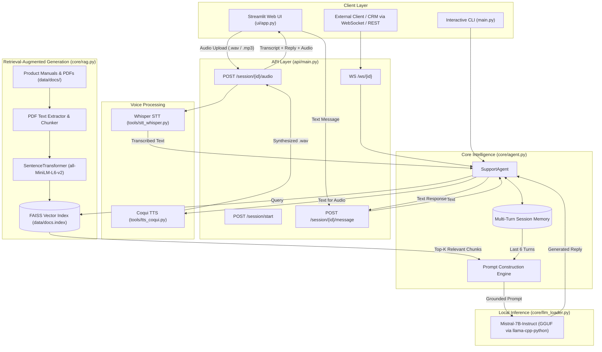

# VOICE.AI — Local Voice & RAG Customer Support Agent

<p align="center">
  
  
  
  
  
  
  
  
  
</p>

<p align="center">
  <strong>An end-to-end, privacy-first, fully offline AI Customer Support Agent powered by local LLMs (Mistral-7B GGUF via llama.cpp), Retrieval-Augmented Generation (RAG with FAISS), Whisper speech recognition, and Coqui neural voice synthesis.</strong>
</p>

---

## Table of Contents

- [Overview](#overview)
- [Key Features](#key-features)
- [Architecture & Workflow](#architecture--workflow)
- [Tech Stack](#tech-stack)
- [System Requirements](#system-requirements)
- [Quick Start Guide](#quick-start-guide)
  - [1. Prerequisites](#1-prerequisites)
  - [2. Clone & Setup Environment](#2-clone--setup-environment)
  - [3. Install Dependencies](#3-install-dependencies)
  - [4. Download the GGUF Model](#4-download-the-gguf-model)
  - [5. Ingest Documentation (PDF RAG)](#5-ingest-documentation-pdf-rag)
- [Running the Application](#running-the-application)
  - [Option A: Full-Stack Web App (FastAPI + Streamlit)](#option-a-full-stack-web-app-fastapi--streamlit)
  - [Option B: Interactive CLI Mode](#option-b-interactive-cli-mode)
- [API Reference](#api-reference)
- [Project Structure](#project-structure)
- [Configuration & Customization](#configuration--customization)
- [Troubleshooting & FAQs](#troubleshooting--faqs)
- [Roadmap](#roadmap)
- [Contributing](#contributing)
- [License](#license)

---

## Overview

Modern customer support requires fast, accurate, and multi-modal assistance. However, relying on cloud-based LLM APIs often introduces severe privacy risks, data compliance hurdles, high token costs, and vendor lock-in.

**VOICE.AI** solves this by providing a **turnkey, production-grade, 100% on-device customer support system**:
- **Zero Cloud Leakage**: All inferences (LLM, Embeddings, STT, and TTS) run strictly on your local hardware.
- **Grounded Responses**: Uses FAISS semantic search across your internal product manuals, warranty guides, and PDFs to virtually eliminate hallucinations.
- **Voice-In, Voice-Out**: Users can speak to the agent and receive spoken audio responses in real time.
- **Multi-Turn Memory**: Preserves context and conversation history across turns to handle complex troubleshooting dialogues.

---

## Key Features

| Feature | Description |
| :--- | :--- |
| **Local LLM Reasoning** | Powered by **Mistral-7B-Instruct** (or any GGUF model) loaded via `llama-cpp-python` with low memory overhead. |
| **Document RAG Indexing** | Ingests PDF manuals, guides, and documentation using `pdfminer.six` and `all-MiniLM-L6-v2` embeddings stored in **FAISS**. |
| **Instant FAQ Lookup** | Keyword-accelerated FAQ matching (`data/faqs.json`) for instant sub-millisecond replies to standard inquiries. |
| **Offline Speech-to-Text (STT)** | Converts spoken audio files into clean text using OpenAI's **Whisper** (`tiny` model for lightweight speed). |
| **Neural Text-to-Speech (TTS)** | Synthesizes realistic, natural-sounding voice responses with **Coqui TTS** (`tacotron2-DDC`). |
| **Interactive Streamlit UI** | Clean web interface supporting text messaging, audio file uploads, and integrated audio playback. |
| **FastAPI Backend & WebSockets** | Robust REST API endpoints and real-time bidirectional WebSocket streaming for external CRM or mobile integration. |
| **Session History Persistence** | Automatic serialization of active chat threads into `data/chat_sessions.json` for auditing and compliance. |

---

## Architecture & Workflow



---

## Tech Stack

| Layer | Component | Implementation |
| :--- | :--- | :--- |
| **Language Model** | Local Quantized LLM | [Mistral-7B-Instruct-v0.2](https://huggingface.co/mistralai/Mistral-7B-Instruct-v0.2) in GGUF format |
| **LLM Runtime** | C/C++ Engine Binding | [llama-cpp-python](https://github.com/abetlen/llama-cpp-python) (CPU multi-threading / CUDA optional) |
| **Embeddings** | Dense Vector Representation | `sentence-transformers` (`all-MiniLM-L6-v2`, 384 dimensions) |
| **Vector Index** | Similarity Search | [FAISS](https://github.com/facebookresearch/faiss) (`IndexFlatL2`) |
| **PDF Extraction** | Document Parsing | `pdfminer.six` |
| **Speech-to-Text** | Audio Transcription | [OpenAI Whisper](https://github.com/openai/whisper) (`tiny` model) |
| **Text-to-Speech** | Neural Audio Synthesis | [Coqui TTS](https://github.com/coqui-ai/TTS) (`tacotron2-DDC`) |
| **Backend API** | High-performance Server | [FastAPI](https://fastapi.tiangolo.com/) + [Uvicorn](https://www.uvicorn.org/) |
| **Frontend UI** | Rapid Interactive GUI | [Streamlit](https://streamlit.io/) |

---

## System Requirements

- **Operating System**: Windows 10/11, macOS (Apple Silicon / Intel), or Linux (Ubuntu 20.04+)
- **Python**: 3.9, 3.10, or 3.11
- **RAM**: Minimum **8 GB** (16 GB recommended for running 4-bit/5-bit quantized 7B models comfortably alongside TTS)
- **Disk Space**: ~6 GB free space (for GGUF weights, Whisper models, and dependencies)
- **Audio Tools**: `ffmpeg` installed and accessible in your system `PATH` (required for audio decoding by Whisper)

---

## Quick Start Guide

### 1. Prerequisites

Ensure you have **Python 3.9+** and **FFmpeg** installed:

#### Windows (via winget or chocolatey):
```powershell
winget install Gyan.FFmpeg
# or
choco install ffmpeg
```

#### macOS (via Homebrew):
```bash
brew install ffmpeg
```

#### Linux (Ubuntu/Debian):
```bash
sudo apt update && sudo apt install -y ffmpeg build-essential
```

---

### 2. Clone & Setup Environment

```bash
# Clone the repository
git clone https://github.com/VaishnavSreekumar/VOICE.AI.git
cd VOICE.AI

# Create a virtual environment
python -m venv venv

# Activate virtual environment
# Windows (PowerShell):
.\venv\Scripts\Activate.ps1
# Windows (CMD):
.\venv\Scripts\activate.bat
# Linux/macOS:
source venv/bin/activate
```

---

### 3. Install Dependencies

Install the core dependencies:
```bash
pip install --upgrade pip
pip install -r requirements.txt
```

> **Note on `llama-cpp-python`:**  
> If you have an NVIDIA GPU and want GPU acceleration via CUDA, install `llama-cpp-python` with:
> ```bash
> pip install llama-cpp-python --extra-index-url https://abetlen.github.io/llama-cpp-python/whl/cu121
> ```

---

### 4. Download the GGUF Model

Create the model directory and download a quantized Mistral-7B GGUF model:

```bash
# Create models directory
mkdir -p data/models
```

You can download `mistral-7b-instruct-v0.2.Q4_K_M.gguf` (~4.37 GB) from Hugging Face:

#### Using PowerShell:
```powershell
Invoke-WebRequest -Uri "https://huggingface.co/TheBloke/Mistral-7B-Instruct-v0.2-GGUF/resolve/main/mistral-7b-instruct-v0.2.Q4_K_M.gguf" -OutFile "data/models/mistral-7b-instruct.gguf"
```

#### Using `curl` (Linux / macOS):
```bash
curl -L -o data/models/mistral-7b-instruct.gguf \
  "https://huggingface.co/TheBloke/Mistral-7B-Instruct-v0.2-GGUF/resolve/main/mistral-7b-instruct-v0.2.Q4_K_M.gguf"
```

#### Using `huggingface-cli`:
```bash
pip install huggingface_hub
huggingface-cli download TheBloke/Mistral-7B-Instruct-v0.2-GGUF mistral-7b-instruct-v0.2.Q4_K_M.gguf --local-dir data/models --local-dir-use-symlinks False
mv data/models/mistral-7b-instruct-v0.2.Q4_K_M.gguf data/models/mistral-7b-instruct.gguf
```

---

### 5. Ingest Documentation (PDF RAG)

Place your product manuals, warranty policies, or technical guides in PDF format into `data/docs/` or index any PDF directly:

```bash
# Index a single manual or documentation PDF
python -m tools.pdf_indexer path/to/your_product_manual.pdf
```

Alternatively, place multiple PDFs in `data/docs/` and run the indexer module:
```bash
python -c "from core.rag import DocStore; ds = DocStore(); ds.index_all(); print('Indexed:', len(ds.texts), 'chunks')"
```

---

## Running the Application

### Option A: Full-Stack Web App (FastAPI + Streamlit)

For the complete interactive experience with text and voice chat:

#### Step 1: Start the FastAPI Backend
```bash
uvicorn api.main:app --host 0.0.0.0 --port 8000 --reload
```
*API will be live at `http://localhost:8000` with interactive Swagger docs at `http://localhost:8000/docs`.*

#### Step 2: Launch the Streamlit Frontend (in a second terminal)
```bash
streamlit run ui/app.py
```
*Your browser will automatically open `http://localhost:8501`.*

---

### Option B: Interactive CLI Mode

If you just want a terminal-based conversation directly with the local agent without running web servers:

```bash
python main.py
```

```
Customer Support Agent — type 'exit' to quit
You: My device won't charge after the update. What can I do?
Agent: Based on the hardware troubleshooting manual, check if the LED indicator pulses...
```

---

## API Reference

The FastAPI service exposes RESTful and WebSocket endpoints for seamless integration:

### 1. `POST /session/start`
Initializes a new support session with isolated conversational memory.

- **Request:** Empty
- **Response:**
  ```json
  {
    "session_id": "4d5f308a-2115-46eb-a5f1-32b005e839e1"
  }
  ```
- **cURL Example:**
  ```bash
  curl -X POST "http://localhost:8000/session/start"
  ```

---

### 2. `POST /session/{session_id}/message`
Sends a text message to the assistant within an active session.

- **Request Body:**
  ```json
  {
    "text": "What is the return policy for defective headsets?"
  }
  ```
- **Response:**
  ```json
  {
    "reply": "According to the warranty guide, defective headsets can be returned within 30 days...",
    "session_id": "4d5f308a-2115-46eb-a5f1-32b005e839e1"
  }
  ```
- **cURL Example:**
  ```bash
  curl -X POST "http://localhost:8000/session/4d5f308a-2115-46eb-a5f1-32b005e839e1/message" \
       -H "Content-Type: application/json" \
       -d '{"text": "What is the return policy for defective headsets?"}'
  ```

---

### 3. `POST /session/{session_id}/audio`
Uploads an audio file (`.wav`, `.mp3`, `.m4a`), transcribes it with Whisper, queries the agent, synthesizes the reply via Coqui TTS, and returns the audio file path.

- **Form Data:** `file` (multipart/form-data audio file)
- **Response:**
  ```json
  {
    "transcript": "How do I pair my headset over bluetooth?",
    "reply": "To pair your headset, hold down the power button for 5 seconds until the LED flashes blue.",
    "wav": "/tmp/tmpxyz123.wav"
  }
  ```
- **cURL Example:**
  ```bash
  curl -X POST "http://localhost:8000/session/4d5f308a-2115-46eb-a5f1-32b005e839e1/audio" \
       -F "file=@customer_query.wav"
  ```

---

### 4. `POST /session/{session_id}/save`
Persists the current conversation history to disk (`data/chat_sessions.json`).

- **Response:**
  ```json
  {
    "status": "saved"
  }
  ```

---

### 5. `WebSocket /ws/{session_id}`
Establishes a bi-directional streaming WebSocket connection for real-time text chat.

- **Protocol:** `ws://localhost:8000/ws/{session_id}`
- **Incoming:** Raw string text message
- **Outgoing:** Raw string agent reply

---

## Project Structure

```
VOICE.AI/
├── api/
│   └── main.py              # FastAPI server (REST endpoints & WebSocket handler)
├── core/
│   ├── agent.py             # SupportAgent orchestrating memory, RAG, & LLM prompts
│   ├── llm_loader.py        # llama-cpp-python GGUF model loader & text generator
│   └── rag.py               # Document ingestion, FAISS indexer, and semantic retriever
├── data/
│   ├── docs/                # Directory where uploaded/indexed product PDFs reside
│   ├── docs.index           # Serialized FAISS vector index (auto-generated)
│   ├── faqs.json            # Fast-lookup structured FAQ knowledge base
│   └── models/              # Local storage directory for GGUF model weights
├── examples/
│   └── sample_convo.json    # Example serialized conversation schema
├── tools/
│   ├── faq_tool.py          # Keyword matcher for quick FAQ answering
│   ├── pdf_indexer.py       # CLI utility to copy & index new PDF manuals
│   ├── stt_whisper.py       # OpenAI Whisper speech-to-text transcription module
│   └── tts_coqui.py         # Coqui TTS audio synthesis module
├── ui/
│   └── app.py               # Streamlit web interface (text & audio chat)
├── .gitignore               # Ignored cache, models, and virtual environments
├── main.py                  # Standalone CLI entrypoint for terminal chat
├── README.md                # Comprehensive project documentation
└── requirements.txt         # Project dependencies and versions
```

---

## Configuration & Customization

### Modifying LLM Settings
In [`core/llm_loader.py`](core/llm_loader.py), you can customize:
- `model_path`: Location of your GGUF file (defaults to `data/models/mistral-7b-instruct.gguf`).
- `n_ctx`: Context window size (default: `4096`).
- `n_threads`: Number of CPU threads dedicated to inference (default: `4`).
- `temp`: Sampling temperature (default: `0.2` for deterministic, factual responses).

### Changing the Embedding Model
In [`core/rag.py`](core/rag.py), change `EMBED_MODEL_NAME` to any Hugging Face sentence transformer, e.g.:
```python
EMBED_MODEL_NAME = "BAAI/bge-small-en-v1.5"  # or "all-MiniLM-L6-v2"
```

### Changing the Voice Model
In [`tools/tts_coqui.py`](tools/tts_coqui.py), override the TTS model via the environment variable `COQUI_TTS_MODEL` or modify the fallback:
```bash
export COQUI_TTS_MODEL="tts_models/en/vctk/vits"
```

### Updating FAQs
Edit [`data/faqs.json`](data/faqs.json) to add custom question-answer pairs with trigger keywords for immediate zero-latency responses:
```json
[
  {
    "question": "How do I reset my password?",
    "keywords": ["reset password", "forgot password"],
    "answer": "Go to Settings -> Account -> Reset password and follow the emailed link."
  }
]
```

---

## Troubleshooting & FAQs

<details>
<summary><strong>1. <code>llama-cpp-python</code> fails to install or compile</strong></summary>

- **Windows**: Install the [Visual Studio C++ Build Tools](https://visualstudio.microsoft.com/visual-cpp-build-tools/) and select the "Desktop development with C++" workload. Alternatively, install prebuilt wheels from [llama-cpp-python releases](https://github.com/abetlen/llama-cpp-python/releases).
- **Linux/macOS**: Ensure `gcc`, `g++`, and `cmake` are installed:
  ```bash
  sudo apt install -y cmake build-essential
  ```
</details>

<details>
<summary><strong>2. <code>FileNotFoundError: [Errno 2] No such file or directory: 'ffmpeg'</code></strong></summary>

Whisper requires `ffmpeg` to decode audio inputs. Make sure FFmpeg is installed and added to your system `PATH`. Test by running `ffmpeg -version` in your terminal.
</details>

<details>
<summary><strong>3. Out of Memory (OOM) or system slowdown</strong></summary>

- Use a higher quantization GGUF model such as `Q4_K_M` or `Q4_0`.
- Reduce context length (`n_ctx=2048`) in `core/llm_loader.py`.
- Reduce the number of CPU threads (`n_threads=2` or `4`).
</details>

<details>
<summary><strong>4. Streamlit cannot connect to the backend</strong></summary>

Ensure the FastAPI server is running in a separate terminal:
```bash
uvicorn api.main:app --port 8000
```
Verify that `http://localhost:8000/docs` is reachable before launching Streamlit.
</details>

---

## Roadmap

- [ ] **Live Audio Streaming**: Native WebSocket microphone streaming for instantaneous voice interaction.
- [ ] **Multi-Lingual Support**: Whisper multilingual translation and multilingual embedding models.
- [ ] **Docker & Docker-Compose**: One-click multi-container deployment with CPU/CUDA profiles.
- [ ] **Admin Knowledge Dashboard**: Web interface for viewing, re-indexing, and deleting PDF manuals dynamically.
- [ ] **Agent Tool Calling**: Integration of external ticketing tools (Zendesk, Jira Service Desk API).

---

## Contributing

Contributions are welcome. If you would like to improve VOICE.AI:

1. **Fork** the repository.
2. Create your feature branch (`git checkout -b feature/amazing-feature`).
3. Commit your changes (`git commit -m 'Add some amazing feature'`).
4. Push to the branch (`git push origin feature/amazing-feature`).
5. Open a **Pull Request**.

---

## License

This project is licensed under the **MIT License** — see the [LICENSE](LICENSE) file for details.

---

<p align="center">
  Maintained by <a href="https://github.com/VaishnavSreekumar">Vaishnav Sreekumar</a>
</p>
